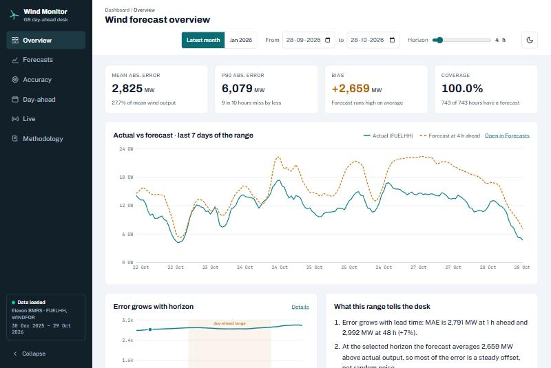
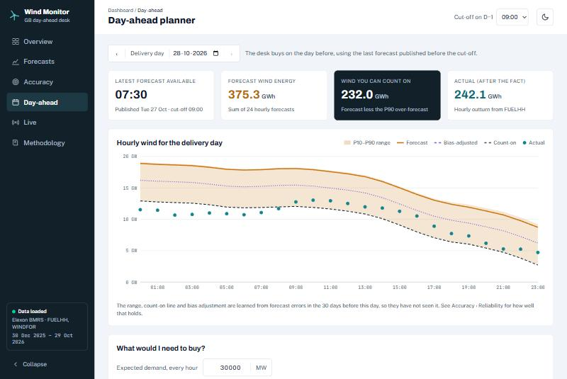
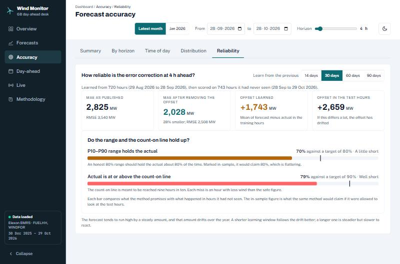
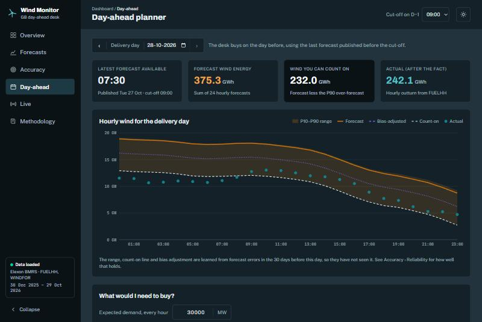
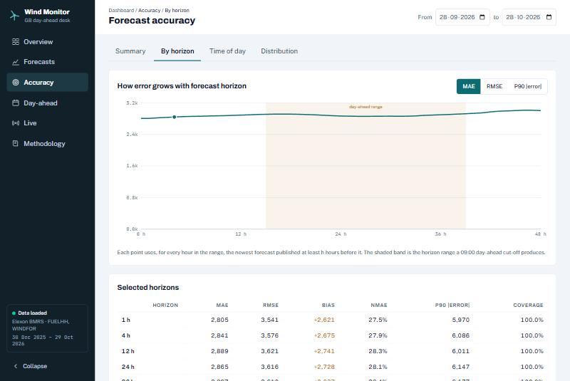
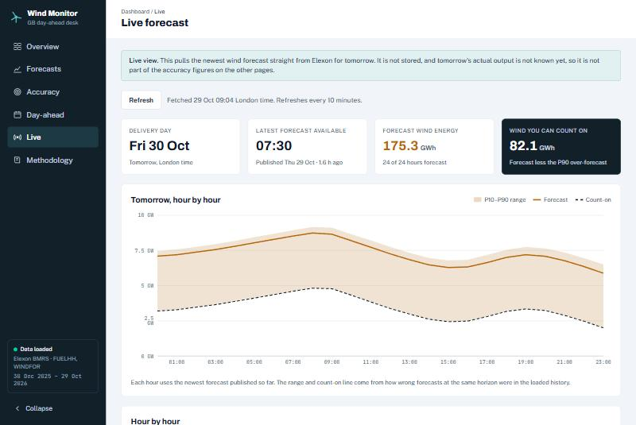

# Wind Forecast Monitor

A web app for a GB energy utility's day-ahead trading desk. It shows the latest national wind forecast available when a buy decision is made, and measures how accurate those forecasts are, so the desk can size its purchases with the error in mind.

- **Data:** Elexon BMRS, national level only. Actuals from `FUELHH` (fuel type `WIND`), forecasts from `WINDFOR`.
- **Stack:** React + TypeScript (frontend), Python FastAPI (backend), PostgreSQL (data), Redis (cache), Docker.

**Live app:** not deployed yet. The Heroku setup is prepared; see [DEPLOY.md](DEPLOY.md).

## What it does

| Page | Answers |
|---|---|
| **Overview** | Headline error numbers, actual vs forecast for the last 7 days, how error grows with lead time, and a findings card computed from the data on screen. |
| **Forecasts** | For any date range, the forecast that was available N hours before each hour next to actual output (chart or table). |
| **Accuracy** | Summary metrics, error by horizon (0 to 48 h), by hour of day, the error distribution with the ten worst misses, and **Reliability**: an out-of-sample test of the P10 to P90 range, the count-on line and a bias adjustment. |
| **Day-ahead** | For a delivery day: the last forecast published before the D-1 cut-off (07:00, 09:00 or 11:00 London), an hourly P10 to P90 range, a bias-adjusted forecast, and a conservative "wind you can count on" line. A **demand what-if** turns that into power still to buy, and the hourly table downloads as CSV. Shows actual output afterwards. |
| **Live** | Tomorrow's hourly forecast from the newest Elexon publish, fetched on demand and not stored. |
| **Methodology** | The selection rule, the metrics and the assumptions in plain language. |







<details>
<summary>More screenshots</summary>







</details>

### The core rule

For each delivery hour, the forecast used is the **newest one published at least *h* hours before it**. Later forecasts would not have been available when the decision was made, so they are never used. If none is early enough the hour is a gap and counts against coverage. Day-ahead mode uses one fixed cut-off on the day before instead of a fixed *h*.

Error is `forecast − actual`, so a positive number means the forecast was too high (the desk is left short). Metrics: MAE, RMSE, bias, nMAE, P50/P90/P99 absolute error, P90 of over-forecasts, correlation and coverage.

## Run it

Needs Docker.

```bash
./startup.sh
```

This builds and starts everything with `docker compose`, waits until the API reports healthy, and prints the URLs. Open <http://localhost:5173>. Other commands: `./startup.sh ingest | logs | stop | reset`. (`docker compose up --build` works too.) On first start the API creates its tables and loads the bundled snapshot (`backend/data/seed.json.gz`, 30 Dec 2025 to 28 Oct 2026), so it works without calling Elexon. To pull fresh data up to today:

```bash
./startup.sh ingest   # or: make ingest
```

Other commands: `make down` (keep data), `make reset` (wipe the database volume), `make test`, `make lint`, `make seed` (rebuild the snapshot from Elexon).

| Service | Port | Notes |
|---|---|---|
| web | 5173 | nginx serving the React build; proxies `/api` to the API |
| api | 8000 | FastAPI; docs at <http://localhost:8000/docs> |
| postgres | 5433 | The database. Published on 5433 in case a local Postgres owns 5432. |
| redis | 6379 | Cache only. Nothing in it matters. |

### Without Docker for the app itself

```bash
docker compose up -d postgres redis
cd backend && python -m venv .venv && .venv/Scripts/pip install -e ".[dev]"   # Windows; use .venv/bin on macOS/Linux
.venv/Scripts/python -m uvicorn app.main:app --reload                        # http://localhost:8000
cd ../frontend && npm install && npm run dev                                  # http://localhost:5173
```

### Tests

```bash
cd backend && python -m pytest -q     # 45 tests; needs the postgres container (docker compose up -d postgres)
cd frontend && npx vitest run         # 20 tests
```

Backend tests run against a real Postgres, each in its own temporary schema, with `fakeredis` for the cache. Where possible the tests use small synthetic data with known answers (for example, one forecast that is always +200 MW off, so the expected MAE at each horizon is exactly known).

## How it is built

```
Browser ── React SPA ── /api/v1 ── FastAPI ──┬── PostgreSQL   actuals, forecasts
                                             ├── Redis        cached results, raw API responses, ingest lock, rate limits
                                             └── Elexon BMRS  ingest, and the live page
```

- **One SQL statement answers the core question.** A lateral join takes, for each actual hour, the newest forecast with `publish_time <= hour − h`. The primary key `(target_time, publish_time)` is also the index for it.
- **Redis is disposable.** Results are cached under `data:version`, which is bumped on every load, so old entries simply expire. If Redis is down the API still answers, only slower.
- **Ingest** is idempotent: one transaction of upserts, guarded by a Redis lock so two runs cannot overlap, in 31-day windows.
- **Frontend state:** one Zustand store per endpoint (previous data stays visible, dimmed, while a new request runs; stale requests are cancelled), a filter store mirrored into the URL so any view is shareable, one axios instance, and skeleton loaders sized like the final layout.

### Files and directories

```
.
├── README.md  DEPLOY.md  Makefile  docker-compose.yml  .env.example
├── startup.sh                         run everything locally in Docker
├── deploy-heroku.sh                   deploy the API to Heroku (run when ready)
├── .github/workflows/ci.yml           lint, type-check and tests for both apps
├── screenshots/                       images used in this README
├── backend/
│   ├── Dockerfile                     multi-stage, non-root, gunicorn + uvicorn workers
│   ├── heroku.yml  app.json           Heroku build and add-on configuration
│   ├── pyproject.toml                 dependencies, ruff, mypy, pytest config
│   ├── data/seed.json.gz              bundled snapshot loaded on first boot
│   ├── scripts/                       ingest.py (CLI), build_seed.py
│   ├── tests/                         unit, repository, ingestion, API and live tests
│   └── app/
│       ├── main.py                    app factory and startup
│       ├── api/v1/routes/             HTTP only: paths, query params, status codes
│       ├── controllers/               argument checks, caching, response shaping
│       ├── services/                  domain logic: selection, metrics, day-ahead, ingest, Elexon client, live
│       ├── repositories/              all SQL (asyncpg); keys.py holds the Redis key names
│       ├── schemas/                   Pydantic request and response models
│       └── core/                      config, db pool and schema.sql, redis, middleware, error handlers
└── frontend/
    ├── Dockerfile  nginx.conf  vercel.json
    └── src/
        ├── api/                       axios instance and one module per endpoint group (v1/)
        ├── store/                     Zustand stores (resource.ts is the shared loader)
        ├── pages/                     overview, forecasts, accuracy/*, day-ahead, live, methodology
        ├── layouts/                   dashboard shell and the nested accuracy tabs
        ├── components/                charts, kpi, filters, layout, skeletons, tables, common
        ├── hooks/  utils/  types/  routes/
```

### API (all under `/api/v1`)

`GET /health` · `GET /meta/coverage` · `GET /generation/{actuals,forecasts,comparison}` · `GET /metrics/{summary,by-horizon,by-hour,distribution,calibration}` · `GET /day-ahead/{date}?cutoff=09:00` · `GET /live/day-ahead` · `POST /admin/ingest` (needs `X-Admin-Token`).

Time ranges are ISO-8601 UTC, end exclusive, capped at 45 days. Bad input returns a 422; exceeding the rate limit returns a 429 with `Retry-After`.

## What the data shows

- Forecast error grows with lead time. In January 2026, MAE is about 1.8 GW at 1 h ahead and 2.4 GW at 48 h.
- The forecast runs **high by a steady amount**: about +1.6 GW in January and about +2.7 GW in the latest month. WINDFOR may cover wind that FUELHH does not meter, which would explain this; it has not been confirmed. The "count-on" line subtracts the P90 over-forecast, so it is conservative.
- The latest month is worse than January (MAE about 2.8 GW at 4 h).
- **Data quality:** a few FUELHH half-hours are exactly 0 MW (4 of about 14,500), each isolated mid-day among smooth neighbours; the lowest genuine reading is about 400 MW. They are treated as missing values and dropped at ingest (and purged from earlier loads). Left in, one of them was the single largest "forecast miss".

- **Out of sample, the range is optimistic.** Tested on the latest month with a 30-day learning window, the "80%" P10 to P90 range held the actual about 70% of the time, and the count-on line (meant to be reached 90% of the time) about 79%. Learning from all history instead gave only about 60%, because the forecast's steady offset drifts through the year (about +1.4 GW over the training months, +2.7 GW in the latest month). Removing the learned offset still cut MAE by about 28%.

## Assumptions and limits

- The brief asks for decisions made in January 2026. The loaded history is wider so the date pickers and Live page are useful; January sits inside it and any January range can be selected.
- The P10 to P90 range, count-on line and bias adjustment are learned from forecast errors in the 30 days before the day shown, so they have not seen it. They are not guarantees: see **Accuracy > Reliability** for how often they held. Only when there is under a week of earlier data (the first days of the history) are they learned from all loaded data, and the page says so.
- The demand what-if uses a flat demand you type in, because demand is not part of the Elexon data this app is limited to.
- The date presets are **Latest month** and **Jan 2026**, the study window the brief asks for. A light/dark toggle is in the top bar.

## AI tools

This project was built with the help of an AI coding assistant, **Claude Code (Anthropic)**, used for planning, writing code and tests, and checking the results against real Elexon data.
